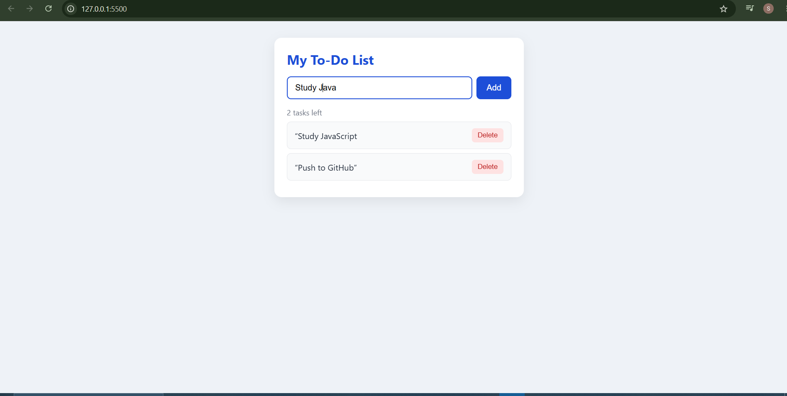
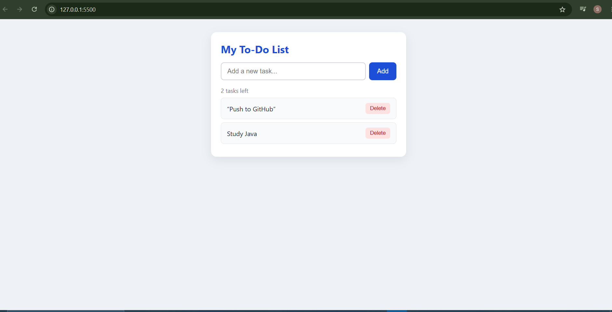

# Task 2 – To-Do List Web App (Vanilla JavaScript)

A front-end only To-Do list built with HTML, CSS and vanilla JavaScript for the Web Development Internship (Elevate Labs).

## Features
- Add tasks with the Add button or the Enter key
- Click a task to mark it complete (strike-through) and click again to undo
- Delete any task with its Delete button
- Counter showing how many tasks are left
- Tasks are saved in the browser (localStorage), so they stay after a page refresh
- Responsive layout for mobile and desktop

## Screenshots

## Concepts used
- DOM selection and manipulation (`getElementById`, `createElement`, `classList`)
- Event listeners and event delegation
- `preventDefault()` on form submit
- ES6: `const`/`let`, arrow functions, template literals, array methods (`filter`, `find`, `forEach`)
- State stored in an array, with a `render()` function that updates the UI instantly

## Tools
- VS Code
- Live Server extension
- Chrome Browser

## Files
- `index.html` – page structure
- `style.css` – styling
- `script.js` – app logic
- `task-2-todo-app-SS1.PNG`, `task-2-todo-app-SS2.PNG` – screenshots of the output

## How to run
1. Clone or download this repository.
2. Open the folder in VS Code.
3. Right-click `index.html` and choose **Open with Live Server**.
